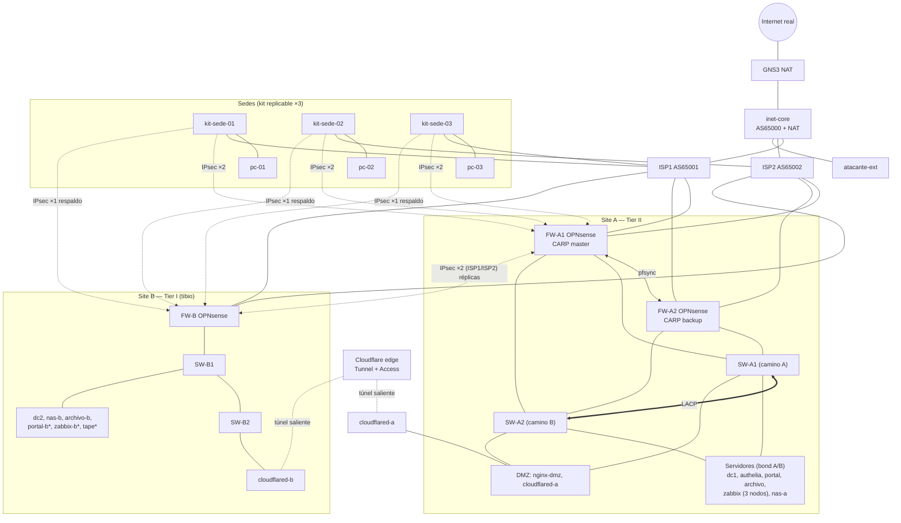

# PLAN DE DESARROLLO — Simulación GNS3 del Centro de Datos "Alcaldía Digital"

> Estado: **APROBADO — plazo 48 h (21/11/2026 → 23/11/2026)**. Repositorio: `Alcaldia-Digital` (https://github.com/evervc-dev/Alcaldia-Digital). Estado vivo en `ESTADO.md`.
> Principio: **MVP primero, sin sobre-ingeniería** (scripts bash + `.env` local; nada de sops/ansible).
> Fuentes: Fase-1 §6 (arquitectura), Fase-2 §2/§4.3/§6 (servicios, RTO/RPO, RQ-01..14), Fase-3 §6–7 (enlaces, cableado), Fase-4 §6 (monitoreo Zabbix + GLPI), Fase-5 §3–4 (respaldo 3-2-1, DRP), `Simulación.md`, `pdf/Proyecto-Final-ACC-2026.pdf` §7 (requisitos mínimos GNS3 y plan de pruebas).

## 0. Inventario actual del entorno

| Elemento | Estado | Implicación |
|---|---|---|
| GNS3 server v3 (127.0.0.1:3080) | Activo, 0 proyectos | Partimos de cero |
| Plantillas | Solo integradas (Cloud, NAT, VPCS, Ethernet switch/hub) | Hay que crear todas las plantillas Docker/QEMU |
| Imágenes IOS/IOU/QEMU | Vacías (solo discos `empty*.qcow2`) | Descargar OPNsense; no hay Cisco |
| Docker 29.9.3 | Activo; postgres, minio, mailpit ya descargados | Base para imágenes propias |
| QEMU + KVM | Disponible (`/dev/kvm`, grupo kvm) | OPNsense acelerado por KVM |
| RAM | 23 GB físicos / ~20 usables | Presupuesto de laboratorio ≤ 12 GB |
| cloudflared | No instalado | Irá como contenedor dentro de GNS3 |

## 1. Equivalencia diseño → simulación

| Diseño documentado | Simulación | Motivo |
|---|---|---|
| 2 × FortiGate 120G HA (Site A) | 2 × **OPNsense 25.x** (QEMU) con CARP + pfsync | HA, multi-WAN, IPsec, Suricata IPS, logs |
| FortiGate 120G (Site B) | 1 × OPNsense (QEMU) | Tier I, sin HA |
| 2 × Catalyst C9300L apilados | 2 × **Open vSwitch** (Docker) + enlace inter-switch LACP | VLAN 802.1Q, LACP, RSTP, SNMP, ~50 MB c/u |
| 2 × C9300L (Site B) | 2 × Open vSwitch | — |
| FortiGate 40F (kit de sede) | **acc/kit-sede** (Alpine: strongSwan + FRR + nftables + dnsmasq) | Kit replicable de ~40 MB; 3 sedes |
| 2 proveedores por sitio | 2 routers ISP (**acc/router**: Alpine + FRR + nftables) + "inet-core" con salida NAT real | Proveedores independientes y CGNAT de sedes |
| Clúster 6 × R360 / 4 × R360 | Contenedores de servicio (uno por rol) | Ligereza |
| NAS RS1226RP+ con instantáneas inmutables | **MinIO** con *Object Lock* (A) + replicación de bucket a MinIO (B) | Inmutabilidad real y réplica 3-2-1 |
| Cinta LTO-9 | Contenedor "tape" que se enciende solo para la copia semanal y se apaga (offline) | Copia fuera de línea |
| UPS/generador/caminos A-B | Etiquetas de "camino de energía" por nodo + script que apaga el camino A o B | Requisito del PDF §7 |
| Zabbix + GLPI (Fase 4) | Zabbix 7 LTS en 3 nodos con imágenes oficiales (db, server, web); GLPI 10 opcional (glpi + mariadb separados) | Igual al documento, sin empaquetados propios |

## 2. Arquitectura y topología

### 2.1 Vista general (ASCII)

```
                          [ INTERNET REAL ]
                                 |
                         (GNS3 NAT node)  <- salida del host
                                 |
                          +-------------+
                          |  inet-core  |  AS 65000, NAT masquerade, "Internet simulado"
                          +-------------+
                        /    |       |    \
                 +------+ +------+ +------+ +---------+
                 | ISP1 | | ISP2 | |atacante| |(cliente |
                 |AS65001| |AS65002| | ext.  | | externo)|
                 +------+ +------+ +------+ +---------+
     WAN1-A / WAN1-B /  \   / \  WAN2-A / WAN2-B         CGNAT 100.64/10
          ...       sedes 1,3 (ISP1)   sede 2 (ISP2)
 ======== SITE A (Tier II) ========            ===== SITE B (Tier I) =====
  ISP1──[wsw]──┬─FW-A1 (OPNsense)──┐            ISP1──FW-B (OPNsense)
  ISP2──[wsw]──┘ │CARP+pfsync│     │            ISP2──┘  │ trunk
               └─FW-A2 (OPNsense)──┤                    SW-B1 ── SW-B2
          lagg failover  │   │     │                     │        │
               SW-A1 ═══LACP═══ SW-A2  (núcleo)       dc2, portal-b(*),
          (camino A)│ \   / │(camino B)               archivo-b, nas-b,
                    │  \ /  │                         zbx (respaldo BD),       
             servidores con bond active-backup        cloudflared-b, tape(*)
             dc1, authelia, portal+pg, archivo,       (*) = detenido (sitio tibio)
             nginx-dmz, cloudflared-a, zabbix,
             zbx-db/server/web, nas-a, mailpit
 IPsec VTI + OSPF:  A<->B por ISP1 y por ISP2 | cada sede: 2 túneles a A (uno por WAN de A) + 1 a B
```

### 2.2 Mermaid — vista general



### 2.3 Redundancia que demuestra el Tier II (Site A)

| Componente | Redundancia | Prueba |
|---|---|---|
| Proveedores | ISP1 + ISP2, *gateway group* en OPNsense (tier 1/tier 2) y BGP en los ISP | Bajar WAN1 → tráfico por WAN2; medir conmutación |
| Firewalls | FW-A1/FW-A2 CARP (VIP en cada VLAN y en WAN), pfsync dedicado, sincronización XMLRPC | Apagar FW-A1 |
| Núcleo | SW-A1 (camino A) / SW-A2 (camino B), LACP inter-switch | Apagar SW-A1 |
| Uplinks FW | `lagg` *failover* (un puerto a cada switch) | Apagar SW-A1 |
| Servidores | `bond0` active-backup (eth0→SW-A1, eth1→SW-A2) = "fuente 1/fuente 2" | Apagar camino A completo (FW-A1 + SW-A1) |
| Túneles | 2 VTI por sede hacia A + 1 hacia B, OSPF con costos 10/20/100 | Bajar túnel o ISP |

Site B (Tier I): un FW, servidores con un solo enlace; SW-B2 solo como expansión (documentado como 2 switches).

## 3. Selección de tecnologías y consumo de RAM

| Nodo(s) | Imagen exacta | Tipo | RAM c/u | Total |
|---|---|---|---|---|
| FW-A1, FW-A2 | OPNsense 25.7 *nano* amd64 (qcow2 convertido) | QEMU/KVM, 1 vCPU, 5 NIC virtio | 1 536 MB (Suricata activo) | 3.0 GB |
| FW-B | OPNsense 25.7 nano | QEMU/KVM, 1 vCPU, 4 NIC | 1 024 MB | 1.0 GB |
| SW-A1/A2, SW-B1/B2 | `gns3/openvswitch:latest` (+ capa `acc/ovs` con snmpd y lldpd) | Docker | ~60 MB | 0.25 GB |
| inet-core, ISP1, ISP2 | `acc/router` (alpine:3.20 + frr 10 + nftables + snmpd) | Docker | ~50 MB | 0.15 GB |
| kit-sede-01..03 | `acc/kit-sede` (alpine + strongswan + frr + nftables + dnsmasq + zabbix-agent2) | Docker | ~50 MB | 0.15 GB |
| pc-0N-a, pc-0N-b (2 por sede, 6 en total) | `acc/pc` (alpine + curl, ldap-utils, bind-tools, nmap, hydra) | Docker | ~20 MB | 0.12 GB |
| webterm (1) | `gns3/webterm` (Firefox en VNC) para demo gráfica interna | Docker | ~300 MB | 0.3 GB |
| dc1, dc2 | `acc/samba-dc` (debian:12-slim + Samba 4.17 AD DC; DNS interno) | Docker | ~250 MB | 0.5 GB |
| authelia | `authelia/authelia:4.38` + `redis:7-alpine` (LDAP → Samba, TOTP) | Docker | ~80 MB | 0.1 GB |
| portal + portal-db (A), portal-b* + portal-db-b | `acc/portal` (Python FastAPI mínimo) + nodo aparte `postgres:16-alpine` | Docker | ~80 + 150 MB | 0.38 GB (portal-b detenido, db-b réplica) |
| archivo, archivo-b | `filebrowser/filebrowser:v2` (auth por cabecera de Authelia) | Docker | ~40 MB | 0.08 GB |
| nginx-dmz | `nginx:1.27-alpine` (reverse proxy + TLS interno) | Docker | ~20 MB | 0.02 GB |
| cloudflared-a/b | `cloudflare/cloudflared:2025.x` | Docker | ~40 MB | 0.08 GB |
| zbx-db, zbx-server, zbx-web | `postgres:16-alpine` + `zabbix/zabbix-server-pgsql:alpine-7.0-latest` + `zabbix/zabbix-web-nginx-pgsql:alpine-7.0-latest` (3 nodos) | Docker | 300 + 250 + 150 MB | 0.7 GB |
| glpi + glpi-db *(opcional)* | `glpi/glpi:10` + `mariadb:11` (2 nodos) | Docker | 250 + 200 MB | 0 en el MVP (0.45 si se agrega) |
| *(oxidized: opcional al final; en el MVP `scripts/backup-configs.sh`)* | — | — | — | 0 |
| syslog | `acc/syslog` (rsyslog + logrotate) | Docker | ~30 MB | 0.03 GB |
| nas-a, nas-b | `cgr.dev/chainguard/minio` (ya descargada) con Object Lock + replicación | Docker | ~250 MB | 0.5 GB |
| tape* | `acc/tape` (restic + volumen offline) | Docker | ~50 MB al usarse | 0 (apagado) |
| mailpit | `axllent/mailpit` (ya descargada; buzón de alertas) | Docker | ~30 MB | 0.03 GB |
| atacante-ext / atacante-sede | `acc/attacker` (alpine + nmap, hydra, curl, hping3) | Docker | ~30 MB | 0.06 GB |
| **Total en marcha (MVP, todo encendido)** | | | | **≈ 7.7 GB** |
| + sobrecarga GNS3/ubridge/QEMU (~15 %) | | | | **≈ 9 GB** |
| Pico con sitio B "caliente" (portal-b encendido + extras GLPI) | | | | **≈ 11 GB** |

Queda ≥ 8 GB para Arch, el navegador y el cliente GNS3. Regla: no superar 12 GB en el laboratorio. Cada fase arranca solo los nodos que necesita.

*Alternativas descartadas:* Cisco IOL (no disponible: requiere licencia de CML), Arista cEOS (~1.2 GB por switch), Keycloak (~700 MB), Nextcloud (~600 MB), OPNsense en cada sede (+3 GB).

## 4. Plan de direccionamiento IP y VLANs

### 4.1 Bloques globales

| Bloque | Uso |
|---|---|
| 10.10.0.0/16 | Site A |
| 10.20.0.0/16 | Site B |
| 10.100.N.0/24 | Sede N (N = 1..255; 139 hoy, 190 en el escenario de crecimiento) |
| 172.16.0.0/16 | Túneles VTI (/30) |
| 203.0.113.0/24 | "Públicas" de ISP1 (rango de documentación) |
| 198.51.100.0/24 | "Públicas" de ISP2 |
| 192.0.2.0/24 | Tránsito inet-core ↔ ISP (/30) |
| 100.64.0.0/16 | CGNAT de sedes (ISP hace NAT → túneles salientes con NAT-T) |
| 192.168.122.0/24 | Red del nodo NAT de GNS3 (salida real) |

### 4.2 VLANs (idénticas en A y B: 10.X0.<VLAN>.0/24, X=1 A, X=2 B)

| VLAN | Nombre | Site A | Site B | Gateway (VIP CARP en A) | Contenido |
|---|---|---|---|---|---|
| 10 | GESTION | 10.10.10.0/24 | 10.20.10.0/24 | .1 (FW-A1 .2, FW-A2 .3) | IP de gestión de switches, oxidized, syslog |
| 20 | SERVIDORES | 10.10.20.0/24 | 10.20.20.0/24 | .1 | dc, authelia, portal, archivo, zabbix, glpi |
| 30 | DMZ | 10.10.30.0/24 | 10.20.30.0/24 | .1 | nginx-dmz, cloudflared |
| 40 | ADMINISTRACION | 10.10.40.0/24 | 10.20.40.0/24 | .1 | Personal del centro (DHCP) |
| 50 | USUARIOS | 10.10.50.0/24 | — | .1 | Usuarios internos / pruebas (DHCP) |
| 60 | RESPALDO | 10.10.60.0/24 | 10.20.60.0/24 | .1 | nas-a/nas-b, tape |
| 99 | HA-PFSYNC | 10.10.99.0/29 (enlace directo, sin switch) | — | — | FW-A1 .1, FW-A2 .2 |

En las sedes: LAN 10.100.N.0/24, GW .1 (kit), DHCP .100–.199; `pc-0N-a` → .100 y `pc-0N-b` → .101 (reserva DHCP por MAC).

### 4.3 Direcciones de servidores (Site A → Site B espejo en 10.20.x)

| Host | IP A | IP B |
|---|---|---|
| dc1 / dc2 (DNS) | 10.10.20.10 | 10.20.20.10 |
| authelia + redis | 10.10.20.11 | — (se arranca en B en DR) |
| portal | 10.10.20.20 | 10.20.20.20* |
| portal-db | 10.10.20.22 | 10.20.20.22 (réplica) |
| archivo | 10.10.20.21 | 10.20.20.21 |
| zbx-server / zbx-web / zbx-db | 10.10.20.30 / .33 / .34 | — (respaldo diario de la BD a nas-b) |
| glpi (opcional) | 10.10.20.31 | — |
| mailpit | 10.10.20.32 | — |
| nginx-dmz | 10.10.30.10 | 10.20.30.10 |
| cloudflared | 10.10.30.11 | 10.20.30.11 |
| syslog | 10.10.10.21 | — |
| SW-A1 / SW-A2 gestión | 10.10.10.11 / .12 | SW-B1/B2 10.20.10.11 / .12 |
| nas-a / nas-b | 10.10.60.10 | 10.20.60.10 |
| tape | — | 10.20.60.20 |

DHCP: Kea en OPNsense (VLAN 40/50 en A y en B); en sedes, dnsmasq del kit. DNS: dc1 primario, dc2 secundario (RQ-13); dominio AD `ad.alcaldia.lab`; zona pública en Cloudflare `evervc.dev`.

### 4.4 Enlaces punto a punto y WAN

| Enlace | Subred | Extremos |
|---|---|---|
| inet-core ↔ ISP1 | 192.0.2.0/30 | .1 core / .2 ISP1 |
| inet-core ↔ ISP2 | 192.0.2.4/30 | .5 core / .6 ISP2 |
| inet-core ↔ NAT GNS3 | DHCP 192.168.122.x | salida real |
| ISP1 ↔ Site A (WAN1) | 203.0.113.0/29 | .1 ISP1, .2 FW-A1, .3 FW-A2, **.4 VIP CARP** |
| ISP2 ↔ Site A (WAN2) | 198.51.100.0/29 | .1 ISP2, .2 FW-A1, .3 FW-A2, **.4 VIP CARP** |
| ISP1 ↔ Site B (WAN1) | 203.0.113.8/30 | .9 ISP1, .10 FW-B |
| ISP2 ↔ Site B (WAN2) | 198.51.100.8/30 | .9 ISP2, .10 FW-B |
| ISP1 ↔ sede 1 / sede 3 | 100.64.1.0/30, 100.64.3.0/30 | .1 ISP, .2 kit (CGNAT) |
| ISP2 ↔ sede 2 | 100.64.2.0/30 | .1 ISP, .2 kit (CGNAT) |
| VTI A↔B por ISP1 / ISP2 | 172.16.0.0/30, 172.16.0.4/30 | .1/.5 A, .2/.6 B |
| VTI sede N → A (WAN1) | 172.16.N.0/30 | .1 A, .2 kit |
| VTI sede N → A (WAN2) | 172.16.N.4/30 | .5 A, .6 kit |
| VTI sede N → B | 172.16.N.8/30 | .9 B, .10 kit |

OSPF área 0 sobre VTI: costo 10 (A por WAN1), 20 (A por WAN2), 100 (B). Las sedes no se ven entre sí (filtrado en A y B, hub-and-spoke).

### 4.5 Matriz de filtrado entre zonas (resumen)

| Origen \ Destino | SERVIDORES | DMZ | GESTION | ADMIN | Sedes | Internet |
|---|---|---|---|---|---|---|
| Internet | ✗ | solo vía Cloudflare Tunnel (no hay puertos abiertos) | ✗ | ✗ | ✗ | — |
| DMZ | portal:8000, archivo:8080, authelia:9091 | — | ✗ | ✗ | ✗ | 443/7844 (cloudflared) |
| Sedes | LDAP/DNS/HTTPS a servicios | ✗ | ✗ | ✗ | ✗ (spoke↔spoke) | vía su ISP |
| ADMIN | todo (con MFA) | ✓ | SSH/HTTPS | — | ✓ soporte | ✓ |
| GESTION | SNMP/agent | ✓ | — | ✗ | SNMP | NTP/updates |
| SERVIDORES | — | ✗ | syslog/SNMP traps | ✗ | ✗ | updates |

Todo bloqueo queda registrado (log en OPNsense → syslog → Zabbix). Suricata en modo IPS en WAN y DMZ.

## 5. Estrategia de persistencia en Docker

**Hecho de GNS3 que lo condiciona:** GNS3 recrea el contenedor al reabrir el proyecto; solo conserva `/etc/network` (interfaces) y los directorios declarados como persistentes (*persistent directories / extra_volumes* de la plantilla, y los `VOLUME` del Dockerfile). Se guardan en `<proyecto>/project-files/docker/<node-id>/`. Todo lo demás se pierde. Lo comprobamos en la Fase 0 con un contenedor "canario".

**Reglas:**
1. **Imagen inmutable + configuración declarativa:** cada rol tiene `images/<rol>/Dockerfile` en git. La configuración base viene de plantillas (`/opt/acc/templates/*.j2` o `envsubst`) y se aplica en el `entrypoint.sh` **solo si no existe** el estado en el volumen (primer arranque idempotente).
2. **`VOLUME` solo para estado**, con rutas estándar por rol:

| Rol | VOLUMEs persistentes |
|---|---|
| acc/router, acc/kit-sede | `/etc/frr`, `/etc/swanctl`, `/etc/nftables.d`, `/etc/dnsmasq.d` |
| ovs | `/etc/openvswitch` |
| samba-dc | `/var/lib/samba`, `/etc/samba` |
| portal | `/var/lib/postgresql/data`, `/srv/portal/uploads` |
| archivo | `/srv/archivo`, `/database` |
| zabbix | `/var/lib/postgresql/data`, `/etc/zabbix` |
| glpi | `/var/lib/mysql`, `/var/www/glpi/files`, `/var/www/glpi/config` |
| nas (minio) | `/data` |
| zbx-db / portal-db | `/var/lib/postgresql/data` |
| cloudflared | sin volumen: el token del túnel entra por variable de entorno (`TUNNEL_TOKEN`) de la plantilla, tomada del `.env` local |

3. **IPs en `/etc/network/interfaces`** (persistido por GNS3), generado desde `inventory/` (bond0 + VLAN o IP plana según el nodo).
4. **Plantilla de ejemplo:**
```dockerfile
FROM alpine:3.20
RUN apk add --no-cache frr strongswan nftables dnsmasq zabbix-agent2 ifupdown-ng bonding tini
COPY rootfs/ /
VOLUME ["/etc/frr", "/etc/swanctl", "/etc/nftables.d", "/etc/dnsmasq.d"]
ENTRYPOINT ["/sbin/tini","--","/opt/acc/entrypoint.sh"]
```
5. **OPNsense (QEMU):** el disco qcow2 vive en el proyecto (persistente). Además, `scripts/backup-configs.sh` copia `/conf/config.xml` por scp a `configs/` (en git, sin contraseñas en claro: se versiona solo tras revisar).
6. **Secretos** en un `.env` local listado en `.gitignore`; en git solo va `.env.example` con nombres de variables.
7. **Respaldo del proyecto GNS3:** un `.gns3project` portable por hito (fuera de git o con Git LFS) y `topology.yaml` como fuente de verdad versionada.

## 6. Estrategia de publicación a Internet real

1. **HTTP(S) → Cloudflare Tunnel (sin abrir puertos ni necesitar IP pública):**
   - `cloudflared-a` (DMZ A) crea conexiones salientes por FW-A → ISP1/ISP2 → inet-core → NAT de GNS3 → Internet real.
   - Nombres públicos (dominio **evervc.dev**): `portal.evervc.dev` → nginx-dmz → portal; `archivo.evervc.dev` → nginx → Authelia (MFA TOTP) → filebrowser; `auth.evervc.dev` → Authelia; `monitor.evervc.dev` (Zabbix) y `mesa.evervc.dev` (GLPI, si se implementa) protegidos además con **Cloudflare Access**.
   - Site B: túnel propio `cloudflared-b`. Conmutación DR = script `scripts/dr-dns-switch.sh` que cambia los CNAME por la API de Cloudflare (TTL bajo). Mide el RTO del portal (coherente con Fase-5 §4.2).
2. **Servicios de red para equipos reales ("VPN de cliente" del diseño):** **Cloudflare Zero Trust (WARP) + rutas privadas** del túnel hacia 10.10.0.0/16 y 10.20.0.0/16. Un portátil o teléfono real con WARP llega a LDAP, DNS, SSH y HTTP internos con identidad + MFA. No necesita IP pública y funciona detrás de CGNAT.
   - Decisión: el host está detrás de **CGNAT**, así que se descarta el *port-forward*. WARP (Zero Trust gratuito) es la única vía de acceso interno desde equipos reales.
3. **Interno del laboratorio:** el NAT de GNS3 solo da salida. La entrada desde Internet real siempre pasa por Cloudflare. No se publica el puerto 3080 de GNS3.

## 7. Infraestructura como código y documentación

```
acc-gns3/                       (repo git → GitHub)
├── AGENTS.md                   reglas para agentes IA, división de tareas
├── PLAN_DESARROLLO.md
├── docs/bitacora/AAAA-MM-DD.md cada acción, error y solución
├── docs/adr/                   decisiones (ADR-001 OPNsense por FortiGate, …)
├── docs/pruebas/               evidencias (capturas, logs, tiempos)
├── inventory/                  hosts.yaml, ipam.yaml (fuente única de IPs/VLAN)
├── topology/topology.yaml      nodos, plantillas, enlaces, camino de energía
├── images/<rol>/               Dockerfile + rootfs/ + entrypoint
├── ESTADO.md                   estado vivo: se actualiza al cerrar CADA fase
├── config/{frr,nginx,authelia,zabbix}/   plantillas de configuración
├── configs/                    respaldos de configuración (backup-configs.sh)
├── scripts/                    host-prep.sh, get-opnsense.sh, pull-images.sh,
│                               build-images.sh, gns3-templates.sh, backup-configs.sh,
│                               power-path.sh A|B on|off, new-sede.sh N,
│                               dr-dns-switch.sh, test-*.sh
├── .env.example                nombres de variables (el .env real no se sube)
└── .gitignore
```
**Regla operativa:** un solo agente a la vez (para no bloquear las consolas de GNS3). Al cerrar cada fase: actualizar `ESTADO.md` (fase, hecho, pendiente, errores conocidos, nodos encendidos, siguiente paso) + bitácora del día + commit + push. Etiqueta git por hito (`F2-ok`…).

## 8. Fases de ejecución (hitos verificables)

### 8.0 Prioridades (plazo de 48 h)

- **MVP (obligatorio):** F0 → F1 → F2 → F3 → F4 → F5 → F6 → F7 + pruebas Tier II (T1–T5).
  - En F6 primero se deja **1 túnel por sede** funcionando; los túneles redundantes vienen después.
- **Mínimos del PDF §7 que no se pueden omitir:**
  - Monitoreo con alertas: **F8 mínima** (Zabbix con SNMP o agente para FW, switches y servicios, y alertas a mailpit).
  - Respaldo de configuraciones: `scripts/backup-configs.sh`.
- **Solo si sobra tiempo:** Suricata IPS, GLPI, oxidized, cinta LTO (contenedor `tape` apagado), mapas avanzados de Zabbix, T6–T9 completas.
- **Plan B inmediato:** si CARP + IPsec VTI falla al primer intento, los túneles se terminan en la IP propia de cada FW y OSPF elige. Se registra en la bitácora; no se depura más.

### 8.1 Cronograma de 48 h

| Bloque | Horas | Fases |
|---|---|---|
| Día 1 mañana | 0–4 | F0 preparación + canario |
| Día 1 tarde | 4–12 | F1 Internet simulado (2 h) + F2 Site A con CARP (6 h) |
| Día 1 noche | 12–18 | F3 Site B + VTI/OSPF + F4 DNS/DHCP/AD |
| Día 2 mañana | 18–28 | F5 servicios críticos + F6 sedes |
| Día 2 tarde | 28–36 | F7 Cloudflare + F8 mínima + backup-configs |
| Día 2 noche | 36–44 | F10 pruebas con evidencias + documentación |
| Colchón | 44–48 | Extras opcionales / correcciones |

### 8.2 Detalle por fase

| Fase | Alcance | Verificación (criterio de aceptación) |
|---|---|---|
| **F0 Preparación** | Repo git + GitHub, estructura, `AGENTS.md`, `ESTADO.md`, bitácora. Cargar módulos `openvswitch`/`bonding`/`8021q` en el host. Descargar OPNsense. Construir imágenes `acc/*`. Crear plantillas GNS3. **Canario de persistencia** | Canario: escribir archivo en un VOLUME → cerrar y reabrir GNS3 → el archivo sigue ahí. `docker images` muestra las imágenes `acc/*` |
| **F1 Internet simulado** | inet-core + NAT, ISP1, ISP2 (BGP), CGNAT | `ping 1.1.1.1` y `curl https://cloudflare.com` desde los ISP; `traceroute` por cada ISP |
| **F2 Red Site A** | FW-A1/A2 (CARP, pfsync, gateway group WAN1/WAN2), SW-A1/A2 (VLAN, LACP), lagg, matriz de filtrado | Inter-VLAN según la matriz. **CARP:** apagar FW-A1 → <3 s de pérdida (`ping -D`). **ISP:** bajar WAN1 → conmuta a WAN2, tiempo registrado |
| **F3 Red Site B + WAN** | FW-B, SW-B1/B2, VTI A↔B por los 2 ISP, OSPF | `show ip ospf neighbor`; ping A↔B; bajar ISP1 → la réplica sigue por ISP2 |
| **F4 Servicios base** | dc1/dc2 Samba AD (DNS, réplica), Kea DHCP, NTP | `dig` contra dc1/dc2; DHCP en VLAN 40; cambio de contraseña en dc1 visible en dc2 en <15 min (RQ-05) |
| **F5 Servicios críticos** | Authelia (LDAP+TOTP), portal+pg, archivo, nginx-dmz; réplica horaria de pg y cada 4 h de archivo a B | Inicio de sesión con MFA (RQ-01); trámite creado en el portal; documento subido y consultado (RQ-03); réplicas presentes en B |
| **F6 Kits de sede ×3** | kit-sede + 2 PC por sede; 2 túneles a A + 1 a B; `new-sede.sh N` genera el kit | pc-0N usa el portal y el archivo por el túnel. Sede 1 no llega a sede 2. Al caer el túnel WAN1 de A, OSPF pasa a WAN2 y luego a B |
| **F7 Publicación** | cloudflared A/B, DNS, Access; WARP para acceso interno | Desde datos móviles: `https://portal.evervc.dev` OK; `archivo` exige MFA; `monitor` exige Access |
| **F8 Monitoreo (mínima)** | Zabbix (SNMP + agentes, descubrimiento, mapa básico A/B/sedes), disparadores aplicables de Fase-4 Tabla 13, alertas a mailpit. *Extras:* webhook a GLPI, syslog, Suricata | Apagar SW-A1 → alerta P2 en <2 min + correo en mailpit (RQ-10) |
| **F9 Respaldos** | `backup-configs.sh` (FW, switches, routers, kits) → `configs/` en git; restic → nas-a (Object Lock) → réplica nas-b. *Extras:* oxidized, tape semanal offline | Borrar la configuración de SW-A1 y restaurarla desde `configs/` (RQ-11). Intentar borrar un objeto bloqueado en nas-a → denegado |
| **F10 Plan de pruebas y DR** | Pruebas obligatorias del PDF §7 + energía + hackeo + pérdida del Site A | Tabla de resultados con tiempos medidos frente a RTO/RPO (abajo) |

### 8.1 Pruebas de F10 (trazadas a requisitos)

| # | Prueba | Procedimiento | Aceptación | Requisito |
|---|---|---|---|---|
| T1 | Conectividad entre zonas | `scripts/test-zones.sh` (matriz §4.5 con nc/curl) | Solo pasa lo autorizado | RQ-09 |
| T2 | Falla de proveedor | Suspender el enlace ISP1–Site A en GNS3 | Servicio continúa; tiempo de conmutación registrado | RQ-08 |
| T3 | Falla del camino de energía A | `power-path.sh A off` (FW-A1, SW-A1, NIC eth0 de los servidores) | Servicios críticos siguen arriba | RQ-07 |
| T4 | Recuperación de un servicio | Detener portal y restaurarlo desde nas-a | RTO medido vs 4 h; diferencia en minutos | RQ-04 |
| T5 | Seguridad entre zonas / hackeo | atacante-ext: **nmap** a las IP públicas y **fuerza bruta básica** (hydra) contra Authelia y SSH; atacante-sede: **aislamiento lateral** (nmap/ping hacia otra sede y hacia GESTION) | Bloqueado y registrado en el log del FW; Authelia bloquea tras N intentos | RQ-09 |
| T6 | Monitoreo | Apagar un switch o un servicio | Alerta en Zabbix + correo (ticket GLPI si se implementa) | RQ-10 |
| T7 | Ransomware simulado | Script cifra `/srv/archivo` → restaurar desde la instantánea inmutable | Datos recuperados dentro del RPO de 4 h | Fase-5 P-R |
| T8 | Pérdida total del Site A | Detener todos los nodos de A → procedimiento P-A (transferir roles FSMO a dc2, arrancar portal-b, cambiar DNS de Cloudflare) | RTO medido por servicio vs Tabla 11 | Fase-5 P-A |
| T9 | Corte de energía prolongado | Simular "generador no arranca" → apagado ordenado de A → P-A | Apagado ordenado documentado | Fase-5 P-E |

## 9. Riesgos técnicos y mitigaciones

| Riesgo | Mitigación |
|---|---|
| CARP + IPsec + VTI en OPNsense HA es delicado | Las VTI terminan en la VIP CARP. Si falla, plan B: los túneles de sede apuntan a cada FW por separado y OSPF elige |
| El bonding en contenedores depende del módulo del host | Comprobar en F0 (`modprobe bonding`). Plan B: dos contenedores por servicio con keepalived |
| La imagen OVS puede requerir el módulo `openvswitch` del kernel | Comprobar en F0. Plan B: imagen `acc/l2switch` (bridge Linux con VLAN filtering + bond) |
| Consumo de RAM | Arrancar por fases; límite de 12 GB; nodos de B detenidos |
| Persistencia en GNS3 distinta a la esperada | Canario en F0 antes de construir nada más |

## 10. Decisiones tomadas (respuestas del 21/11/2026)

| # | Tema | Decisión |
|---|---|---|
| 1 | Switches | Open vSwitch (no hay Cisco IOL) |
| 2 | Kit de sede | Docker ligero (strongSwan + FRR + nftables + dnsmasq) |
| 3 | Sedes | 3 sedes con 2 PC de funcionario cada una; sin impresoras ni escáneres |
| 4 | Dominio | `evervc.dev`; subdominios portal/archivo/auth/monitor/mesa; Zero Trust gratuito |
| 5 | Equipos reales | Web (portal/archivo) + WARP para acceso interno; el host está tras CGNAT |
| 6 | MFA | TOTP con Authelia |
| 7 | GLPI | Opcional, al final si sobra tiempo |
| 8 | Cinta LTO | Contenedor apagado (opcional al final) |
| 9 | Hackeo | nmap, fuerza bruta básica, aislamiento lateral |
| 10 | Repositorio | `Alcaldia-Digital` → https://github.com/evervc-dev/Alcaldia-Digital |
| 11 | Agentes | Uno a la vez; `ESTADO.md` actualizado al terminar cada fase |
| 12 | Marcas | La tabla de equivalencias de §1 es suficiente |
| 13 | Entrega | 48 h desde el 21/11/2026 |
| — | IaC | Sin sops/age ni ansible: `.env` local + scripts bash |
| — | Contenedores | Imágenes oficiales en nodos separados (sin s6 ni empaquetados propios) |
