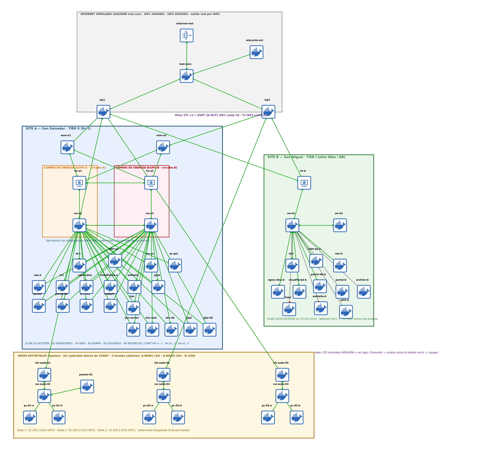

# Topología — nodos, plantillas, enlaces y camino de energía

Camino de energía: **A** = UPS A / circuito A; **B** = UPS B / circuito B; **AB** = doble fuente (sobrevive a la pérdida de un camino); **—** = fuera del alcance de la energía del sitio.
`scripts/power-path.sh A off` apaga los nodos del camino A y desconecta la interfaz del camino A (eth0) de los nodos AB.

## Internet simulado
| Nodo | Plantilla | Interfaces |
|---|---|---|
| NAT | NAT (integrada) | → inet-core eth0 |
| inet-core | ACC-Router | eth0 NAT, eth1 ISP1, eth2 ISP2, eth3 atacante-ext |
| isp1 | ACC-Router (6 adaptadores) | eth0 core, eth1 wsw-a1 (WAN1 A), eth2 FW-B WAN1, eth3 sede 1, eth4 sede 3 |
| isp2 | ACC-Router | eth0 core, eth1 wsw-a2 (WAN2 A), eth2 FW-B WAN2, eth3 sede 2 |
| atacante-ext | ACC-PC | eth0 inet-core |

## Site A (Tier II)
| Nodo | Plantilla | Energía | Interfaces |
|---|---|---|---|
| wsw-a1, wsw-a2 | ACC-OVS (4 puertos; sustituyen al switch integrado de GNS3, que falló al reabrir) | — (lado del proveedor) | eth1 ISP, eth2 fw-a1, eth3 fw-a2 |
| fw-a1 | ACC-OPNsense | A | vtnet0 WAN1 (wsw-a1), vtnet1 WAN2 (wsw-a2), vtnet2 trunk → sw-a1 eth1, vtnet3 pfsync ↔ fw-a2 |
| fw-a2 | ACC-OPNsense | B | igual, pero vtnet2 trunk → sw-a2 eth1 |
| sw-a1 | ACC-OVS | A | eth1 trunk fw-a1, eth14+eth15 LACP ↔ sw-a2, eth3 adm-pc, eth4–13 eth0 de los servidores, mgmt 10.10.10.11 |
| sw-a2 | ACC-OVS | B | eth1 trunk fw-a2, eth14+eth15 LACP ↔ sw-a1, eth3 adm-pc, eth4–13 eth1 de los servidores, mgmt 10.10.10.12 |
| dc1 | ACC-Samba-DC | AB | bond0 (eth0 → sw-a1 eth4, eth1 → sw-a2 eth4), VLAN 20, 10.10.20.10 |
| usr-pc | ACC-PC | A | eth0 → sw-a1 eth5, VLAN 50, DHCP |
| adm-pc | ACC-PC | AB | bond0 (eth0 → sw-a1 eth3, eth1 → sw-a2 eth3), VLAN 40, 10.10.40.50 |
| dc1, authelia, redis, portal, portal-db, archivo, nginx-dmz, cloudflared-a, zbx-db, zbx-server, zbx-web, mailpit, nas-a, glpi (sw eth0/eth0), glpi-db (sw-a1 eth8, sw-a2 eth5) | varias | AB | bond0 active-backup (eth0 → sw-a1, eth1 → sw-a2) |

## Site B (Tier I)
| Nodo | Plantilla | Energía | Interfaces |
|---|---|---|---|
| fw-b | ACC-OPNsense | A | vtnet0 WAN1, vtnet1 WAN2, vtnet2 → sw-b1 |
| sw-b1, sw-b2 | ACC-OVS | A | sw-b1 ↔ sw-b2 |
| dc2 | ACC-Samba-DC | A | eth0 → sw-b1 eth4, VLAN 20, 10.20.20.10 |
| adm-pc-b | ACC-PC | A | eth0 → sw-b1 eth3, VLAN 40, 10.20.40.50 |
| portal-db-b, portal-b*, archivo-b, nginx-dmz-b, cloudflared-b, nas-b, tape* | varias | A | eth0 (un solo enlace) |

## Sedes (kit replicable)
| Nodo | Plantilla | Interfaces |
|---|---|---|
| kit-sede-0N | ACC-Kit-Sede | eth0 WAN (CGNAT del ISP), eth1 LAN → sw-sede-0N |
| sw-sede-0N | Ethernet switch (integrado) | kit, pc-0N-a, pc-0N-b |
| pc-0N-a, pc-0N-b | ACC-PC | eth0 LAN (DHCP) |

`*` = detenido (sitio tibio).

## Diagrama

`topologia.png` y `topologia.svg` se generan desde el lienzo de GNS3: export del MCP (`topologia-gns3.svg`) → fuente DejaVu y texto sin recortar → `rsvg-convert -b white -z 1.4`. La entrega completa (topología portátil, diagrama, configuraciones, pruebas e imágenes) la arma `scripts/exportar-entrega.sh` en `../entrega/`, fuera del repositorio.
